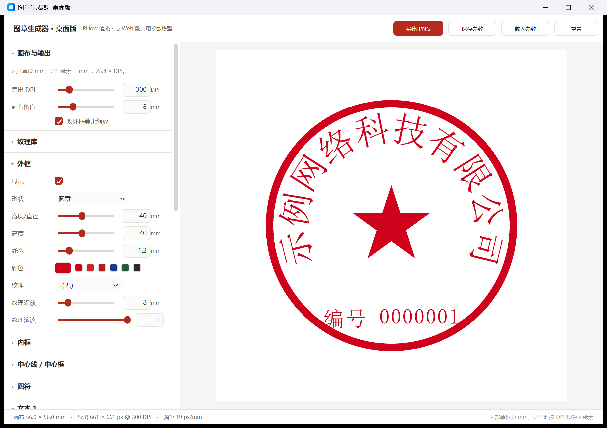

<div align="center">
  
  <h1>SealMaker · 图章生成器</h1>
  <p><b>一套参数模型，两种实现。</b><br>
  单文件网页版（Canvas 2D）· Python 桌面版（Pillow + customtkinter）<br>
  参数 JSON 双向互通，同一份参数在两端渲染结果一致。</p>
  <p><a href="https://longteng-h.github.io/SealMaker/"><b>▶ 在线试用（浏览器直接打开，无需安装）</b></a></p>
</div>

> ⚠️ **仅限合法用途。** 本项目用于自制印章效果图、票据与文档排版、设计稿演示、逆向工程学习。
> **严禁**用于伪造公文、证件、印章或任何违法用途，使用者自行承担全部法律责任。

---

## 这是什么

起点是一个 1.26 MB 的 Windows 老程序（Delphi VCL，带私有壳）。逆向读出它的绘制规则后，把整套参数与算法抽象成一份 JSON 契约，再用现代技术重写了两端——**不是照着截图临摹，而是把角度、坐标、内径比这些原始数值逐个还原出来**。

| | 网页版 | 桌面版 |
|---|---|---|
| 文件 | `图章重构/图章生成器.html`（单文件，不联网） | `图章重构/图章生成器.py` |
| 渲染 | Canvas 2D 矢量 | Pillow 位图 + 超采样 |
| 界面 | 原生 HTML/CSS | customtkinter（圆角扁平、跟随 DPI） |
| 独有能力 | 导出 SVG | 载入本地纹理文件夹 |
| 依赖 | 无，双击即用 | Python 3.10+ / Pillow / customtkinter |

## 效果

<table>
<tr>
  <td align="center"><br><sub>默认参数（无纹理）</sub></td>
  <td align="center"><br><sub>外框与文字「斑驳」、内圈「网点」</sub></td>
  <td align="center"><br><sub>底部文字「绕中心排布」</sub></td>
</tr>
</table>

<p align="center"><br><sub>桌面版界面</sub></p>

## 功能

| 模块 | 能做什么 |
|---|---|
| **外框** | 圆章 / 椭圆章 / 方章 / 菱形章 / 三角章 5 种；线宽、颜色独立。圆章只认直径，拖高度等于拖直径，两个控件自动同步 |
| **内框** | 跟随外框形状，尺寸与线宽独立 |
| **中心线 / 中心框** | 横线或矩形，可偏移，自动居中 |
| **图符** | 五角星（内径比可调，默认 `sin18°/sin54° ≈ 0.38197`）或自定义 PNG |
| **文本** | 3 段独立文本，每段可设字体 / 加粗 / 字号 / 字宽拉伸 / 字距 / 颜色，并支持 3 种排法：**环排**（起始角 + 角度步进，可自动）、**弧排**（居中、可跨角）、**平排** |
| **纹理** | 画笔纹理只调制墨迹浓淡，不改颜色。4 种程序化生成（斑驳 / 细颗粒 / 斜纹 / 网点）+ 外部 PNG，每个对象可单独设浓淡 |
| **尺寸联动** | 改外框时内容等比缩放（内框、图符、文字、三条线宽一起缩），可一键关掉退回全绝对值 |
| **导出** | PNG（写入 DPI 元数据）、SVG（网页版）、JSON 参数（两端通用） |

## 快速开始

**方式一：下载 exe** —— [Releases · v1.0.0](https://github.com/longteng-H/SealMaker/releases/latest)

| 文件 | 说明 | 体积 | 启动 |
|---|---|---|---|
| `SealMaker_v1.0.0_windows_x64_portable.zip` | 目录版（推荐）：解压后双击 `图章生成器.exe` | 34 MB | ≈1.8 秒 |
| `SealMaker_v1.0.0_windows_x64_single.exe` | 单文件版：一个 exe 双击即用 | 34 MB | ≈5.5 秒（每次启动要解压） |

不需要装 Python 或运行库，整个文件夹拷到哪都能用。

**方式二：网页版** —— 直接打开 <https://longteng-h.github.io/SealMaker/>，浏览器里就能用，不装任何东西。
单文件、纯本地运算，参数和图片都不上传服务器。想离线用就双击 `图章重构/图章生成器.html`，是同一份代码。

**方式三：源码运行**

```bash
pip install pillow customtkinter
python "图章重构/图章生成器.py"
```

## 参数模型

所有尺寸走**毫米**，导出时才换算像素；角度以 12 点方向为 0°、顺时针为正。

| 项 | 规则 |
|---|---|
| 单位换算 | `px = mm / 25.4 × dpi` |
| 环排坐标 | `x = cx + R·sin a`，`y = cy − R·cos a` |
| 角度序列 | `a_i = (startAngle + i × stepAngle) mod 360` |
| 五角星内径比 | `sin18° / sin54° ≈ 0.38197` |
| 画布尺寸 | 只按外框算（`外框 + 留白×2`），圆章按方形 |
| 纹理 | LCG 程序化生成，种子 `20241117` |

默认参数就是一个完整的 JSON 契约，共 **104 个叶子字段**，两端逐字段同名：

```json
{
  "frame":  { "shape": "circle", "w": 40.0, "stroke": 1.2, "color": "#d0021b" },
  "texts":  [
    {
      "content": "示例网络科技有限公司",
      "mode": "ring",
      "radius": 15.2, "startAngle": -103.5, "stepAngle": 23.0,
      "size": 5.6, "stretch": 1.0, "spacing": 0.0
    }
  ],
  "out": { "dpi": 300 }
}
```

完整契约见 [`图章重构/参数模型约定.md`](图章重构/参数模型约定.md)。

## 目录结构

```
图章逆向/                   逆向分析过程（报告 + 证据）
  图章逆向分析报告.md        313 行：壳、DFM 结构、关键算法定位
  证据/                     关键汇编片段、DFM 解析脚本、内置说明原文
图章重构/                   双端源码
  图章生成器.html            网页版：单文件，1134 行
  图章生成器.py              桌面版：Pillow 渲染 + customtkinter 界面
  参数模型约定.md            两端唯一的契约文档
  纹理/                     外部纹理放这里（PNG/JPG/WEBP）
docs/img/                   README 用图
docs/index.html             网页版的发布副本（GitHub Pages 入口，由 打包.cmd 同步）
打包说明.md                  打包成 exe 的完整命令与踩坑记录
打包.cmd                    双击一键打两版 exe
```

## 打包成 exe

```bash
python -m PyInstaller --noconfirm --clean --onedir --windowed ^
  --name "图章生成器" --icon "图章重构\app.ico" ^
  --collect-all customtkinter --distpath "发布" "图章重构\图章生成器.py"
```

两个必须注意的点：`--icon` 要写绝对路径（相对路径会按 spec 目录解析），以及必须 `--collect-all customtkinter`（主题 JSON 是包内数据）。其余坑见 [`打包说明.md`](打包说明.md)。

## 一致性是怎么保证的

两端各写一遍，最容易的就是悄悄跑偏。做法是：

1. **参数层**：`参数模型约定.md` 是唯一契约；有脚本比对两端 `defaultParams()` 的字段名与默认值，104 个字段全部对齐。
2. **算法层**：同一个公式写在两处，注释里互相标注对应函数名（`designBox()` ↔ `design_box()`、`uiScale()` ↔ `ui_scale()`）。
3. **视觉层**：仓库里的三张示例图就是对照样张，两端各自导出后比对；纹理算法要求逐像素一致（最大差值 0）。
4. **改一处必须同步另一处**——这条写在文档第一节，改完跑一遍比对脚本。

## 性能

300 DPI、56 mm 画布（661×661）实测：

| 过程 | 优化前 | 现在 |
|---|---|---|
| 网页版 · 预览 | 38 ms | **24 ms** |
| 桌面版 · 导出（3× 超采样） | 103 ms | **87 ms** |

优化手段：纹理按块预生成而不是逐像素算、字符图层按「字格（advance × 行框）」建而不是按墨迹建、弧排压缩时字形与间距同比压缩（防叠字）。

## 已知限制

- **自定义图符跨端失效**：网页版把图片内联成 dataURL 存进 JSON，桌面版存的是本地文件路径，跨端载入该字段要重新选图。
- **非圆章的等比缩放**：宽高各自触发、各用自己维度的比例。把 40×40 的方章高度拖到 18，内容会缩到 0.45 倍、宽方向留空——均匀缩放无法表达非等比变形，这是显式取舍（可关闭联动）。
- **留白小于半个线宽**时，外框描边有一半落在纸外会被裁掉（留白 0 时外圈看起来被削平一点）。两端行为一致。
- 单文件 exe 每次启动都要解压，约 5.5 秒；要快就用目录版。

## 文档

| 文件 | 内容 |
|---|---|
| [`图章重构/参数模型约定.md`](图章重构/参数模型约定.md) | 参数契约、算法约定、同步清单、性能、已知差异 |
| [`图章逆向/图章逆向分析报告.md`](图章逆向/图章逆向分析报告.md) | 壳的识别、DFM 资源解析、环排角度与五角星内径比的汇编依据 |
| [`打包说明.md`](打包说明.md) | 打包命令、五个坑、图标与版本信息 |

## 许可

本仓库不包含原程序的二进制文件，源码为独立重写实现。

**未指定开源许可**，保留所有权利；如需在项目中引用或二次分发，请先联系作者。
